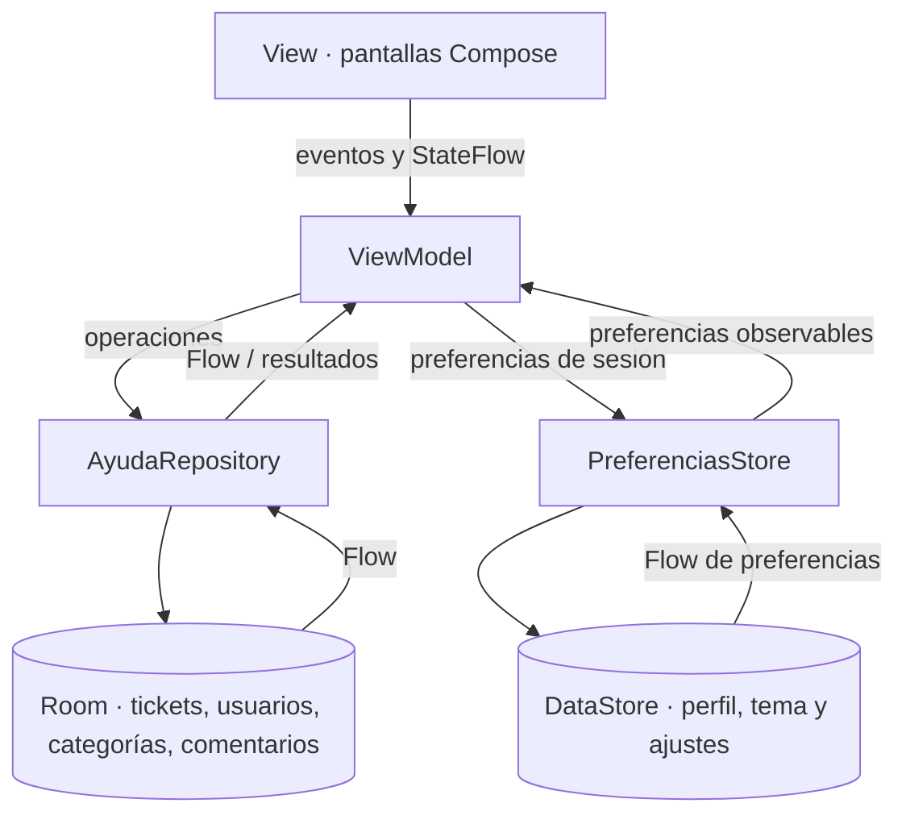

# AyudaCampus

Aplicación Android para gestionar solicitudes de soporte TI en un campus. Los estudiantes pueden registrar, consultar, comentar, calificar y reabrir tickets; el perfil de Soporte TI permite atenderlos, responder, cambiar su estado y administrar categorías.

## Tecnologías

- Kotlin y Jetpack Compose con Material 3.
- Room para usuarios, categorías, tickets y comentarios.
- DataStore Preferences para perfil activo y preferencias.
- Navigation Compose para los flujos Estudiante y Soporte TI.
- ViewModel y StateFlow para mantener la interfaz sincronizada con los datos.

## Ejecutar

Abre el proyecto en Android Studio y ejecuta la configuración `app` en un emulador Android. La base local se inicializa con datos de demostración.

| Perfil | Correo | Clave |
| --- | --- | --- |
| Mayra (Estudiante) | `mayra@campus.test` | `1234` |
| Soporte TI | `soporte@campus.test` | `admin` |

El inicio de sesión ignora espacios al principio o al final y no distingue mayúsculas en el correo. La base local usa migración destructiva para este proyecto de demostración: al cambiar la versión del esquema se reinician los datos Room y se cargan nuevamente los ejemplos.

## Estructura de paquetes

```text
com.tecsup.ayudacampus
├── data
│   ├── local
│   │   ├── dao/          # Consultas y escrituras Room
│   │   ├── entity/       # Usuario, Categoría, Ticket y Comentario
│   │   └── relation/     # TicketConDetalle
│   ├── prefs/            # PreferenciasStore (DataStore)
│   └── repository/       # AyudaRepository y su implementación Room
├── domain/model/         # Estados, prioridades y reglas del dominio
├── model/                # Modelos de presentación
├── ui
│   ├── cliente/          # Login, tickets, detalle, formulario y perfil
│   ├── soporte/          # Panel, bandeja, atención, categorías y ajustes
│   ├── navigation/       # Rutas y grafo NavAyuda
│   ├── components/       # Componentes Compose compartidos
│   ├── graficos/         # Gráficos del panel
│   └── theme/            # Tema Material 3
└── viewmodel/            # Estado y acciones de las pantallas
```

## Diagrama MVVM



Las pantallas observan `StateFlow` y envían acciones al ViewModel. El repositorio oculta el acceso a Room; `PreferenciasStore` mantiene preferencias pequeñas en DataStore. Room y DataStore emiten cambios observables, por lo que ambos perfiles reciben actualizaciones sin reiniciar la aplicación.

## Capturas

### Estudiante


### Soporte TI


## Pruebas de aceptación en emulador

Ejecutadas manualmente en el AVD `Medium_Phone`, con la aplicación instalada desde `assembleDebug`.

| Prueba | Resultado observado | OK |
| --- | --- | :---: |
| Login con clave incorrecta | Muestra “Correo o contraseña incorrectos” y conserva el login. | ☑ |
| Estudiante: crear ticket vacío | Muestra errores de categoría, título y descripción; no crea ticket. | ☑ |
| Estudiante: crear ticket válido | Crea `#0007` como `ABIERTO`, con prioridad Alta. | ☑ |
| Soporte: bandeja | El ticket nuevo aparece primero; los tickets Alta preceden a prioridades menores. | ☑ |
| Soporte: pasar a En proceso y responder | El estudiante ve el nuevo estado y la respuesta al cambiar de perfil, sin reiniciar la app. | ☑ |
| Soporte: intentar cerrar un ticket | La opción Cerrado está deshabilitada para Soporte. | ☑ |
| Soporte: marcar Resuelto | El estudiante ve el aviso verde, califica con 4 estrellas y cierra el ticket. | ☑ |
| Estudiante: reabrir un ticket resuelto | El ticket `#0003` volvió a `ABIERTO`; la sección de evaluación dejó de mostrarse. | ☑ |
| Comentar en ticket cerrado | En `#0007` cerrado no aparece el campo para escribir comentarios. | ☑ |
| Panel | Siete tickets en total; contadores y gráficos coinciden con la bandeja. La alerta muestra 1 ticket Alta abierto con más de una hora. | ☑ |
| Desactivar categoría | Al desactivar Software en Soporte, dejó de aparecer en el selector del estudiante; después se reactivó. | ☑ |
| Cerrar y abrir la app | Los tickets, el perfil Soporte y el modo oscuro persistieron tras detener y abrir de nuevo la aplicación. | ☑ |

## Para pensar

El repositorio no contiene la lista literal de preguntas “Para pensar”. Estas respuestas resumen las decisiones y el comportamiento que se pueden explicar a partir de la implementación:

1. **¿Por qué usar Room para tickets y DataStore para preferencias?** Room modela entidades relacionadas y permite consultas reactivas; DataStore es apropiado para valores pequeños como el perfil, el tema y los ajustes.
2. **¿Cómo se actualiza un ticket en el otro perfil sin reiniciar la app?** Los DAO de Room exponen `Flow`; el repositorio y los ViewModel lo convierten en estado observable para Compose.
3. **¿Qué aporta separar View, ViewModel y Repository?** La UI presenta datos y eventos, el ViewModel contiene el estado y las acciones de pantalla, y el repositorio centraliza el acceso a las fuentes locales.
4. **¿Qué se conserva al cerrar la aplicación?** Los tickets y conversaciones viven en Room; el perfil activo y las preferencias se guardan en DataStore y se recuperan al iniciar.
5. **¿Por qué limitar los estados de un ticket según el rol?** El flujo evita que Soporte cierre directamente un ticket y permite que el estudiante confirme la solución con una calificación antes de cerrarlo.
6. **¿Qué alcance tiene el cambio de perfil?** Es un modo de práctica entre usuarios locales de demostración; limpia la pila de navegación y actualiza el perfil guardado sin volver al formulario de login.
